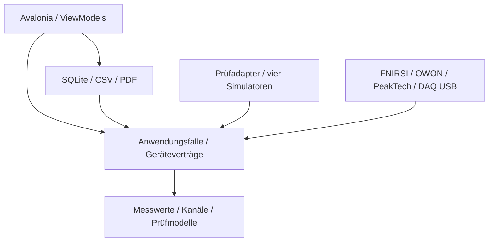

# Architektur

Views binden an ViewModels aus CommunityToolkit.Mvvm. Die zentrale Composition Root in `App` erstellt die Dienste über Microsoft.Extensions.DependencyInjection. ViewModels wählen Gerätefunktionen über die typisierten Verträge der Anwendungsschicht. Protokollframes, Register und SCPI-Telegramme werden in den Treiberprojekten verarbeitet.

## Gerätesitzungen

`Equipment` fasst die vier Gerätetypen eines Betriebsmodus zusammen. `DeviceManager` serialisiert manuelle Befehle, Prüfabläufe, Moduswechsel und Freigaben. Die Telemetrie wartet auf einen freien Slot und pausiert während exklusiver Prüfungen. Laufende Prüfungen veröffentlichen ihre eigenen Messblöcke über denselben Datenpfad. Die physischen Adapter schützen die jeweiligen Endpunkte über Prozessgrenzen hinweg und erkennen Verbindungsfehler.

Vor einem Quellwechsel prüft der Ablauf Toleranzen, Eingangsbereich, Schnittstellenfunktionen und den bestätigten AUS-Zustand. Für Abbruch und Fehler verwendet er separate Zeitlimits für das Wiederherstellen des sicheren Zustands. Fehlende Rückbestätigung erscheint als unbekannter Ausgangszustand mit Aufforderung zur Kontrolle am Prüfaufbau. Ein Wechsel in die Hardwareansicht aktiviert keine Ausgänge.

## DAQ und Messdaten

`IDaqDevice` liefert `DaqFrame`-Blöcke. Jeder Block enthält Sequenz, Zeitbasis und je Kanal die verfügbaren Rohwerte, skalierten Mittelwerte, korrigierten Werte, Min/Max, Sollwerte und Statistik. Unbekannte Werte bleiben optional. Der Transport wird über eine `IDaqDevice`-Implementierung ausgetauscht. Die USB-Anbindung setzt ausschließlich die vorhandenen Befehle des Firmware-Serviceprotokolls 1 um. Host-Sequenz und Host-Zeit begleiten USB-Diagnosesnapshots. Die Streaming- und Zeitsynchronisationsfähigkeiten hängen von der Firmware ab.

Der Messdienst verwendet je nach Sitzung konservative Einzelabfragen. Ein Ringpuffer von 3.200 Blöcken begrenzt den Arbeitsspeicher. Das UI zieht Diagrammfenster aus dem Puffer und zeichnet pro Kurve bis zu etwa 600 Punkte. Daten unterschiedlicher Einheiten erscheinen auf getrennten Achsen. Die CSV-Aufzeichnung nutzt eine eigene, begrenzte Warteschlange und meldet Datenrückstau. Sie schreibt die empfangenen Blöcke getrennt von SQLite und enthält ihre Herkunft. Eine verifizierte Erfassung mit 8 kS/s pro Kanal setzt einen aggregierten DAQ-Datenstrom voraus.

## Ablauf und Datenhaltung

Engine, Auswertung und Koeffizientenfreigabe sind unabhängig von Avalonia. Historieneinträge sind atomare, unveränderliche Snapshots mit Profilrevision und Referenzmetadaten. Das Schreiben neuer Koeffizienten wird als eigener, nachvollziehbarer Vorgang erfasst. [Schema und Berichte](../development/data.md)

Strukturierte Logs nutzen Microsoft.Extensions.Logging. Meldungen bleiben im einblendbaren Ereignisprotokoll sichtbar und werden je Tag als JSONL im lokalen Datenordner abgelegt. Gerätedaten und Benutzerfreigaben werden lokal verarbeitet.

## Paketwahl

Avalonia Desktop und Fluent 12.1.6, CommunityToolkit.Mvvm 8.4.2, Microsoft.Extensions 10.0.15 für DI und Logging. ScottPlot.Avalonia 5.1.59 bietet native Zeitreihen, Zoom und Cursor und unterstützt Avalonia 12 mit einem MIT-lizenzierten Kern. PDFsharp-MigraDoc 6.2.4 ist die MIT-lizenzierte PDF-Version. SQLite nutzt den Betriebssystem-Treiber von Windows. Die übrigen konkreten Abhängigkeiten stehen direkt in den Projektdateien. [Avalonia Desktop](https://www.nuget.org/packages/Avalonia.Desktop/12.1.6) · [ScottPlot für Avalonia](https://www.nuget.org/packages/ScottPlot.Avalonia/5.1.59) · [PDFsharp-MigraDoc 6.2.4](https://www.nuget.org/packages/PDFsharp-MigraDoc/6.2.4)
